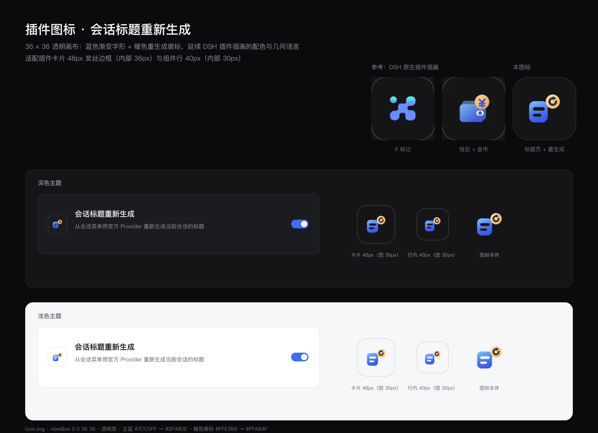

# 插件图标设计记录

日期：2026-11-12（Asia/Shanghai）
目标：为「会话标题重新生成」插件做一张与 DSH Desktop 原生插画风格一致的 36×36 图标，替换模板占位图标。

## 结论

`icon.svg` 已替换为「标题页 + 重生成徽标」图形：标题页是蓝色渐变圆角矩形，两条透明裁切代表标题与正文；
右上角暖色圆形徽标内嵌深色循环箭头，表示重新生成。图形透明底、无自绘外框，交由 DSH 的 48px 发丝边框卡片承载。

## 官方契约（依据）

- 清单通过 `"icon": "./icon.svg"` / `exports"./icon"` 提供图片，插件卡片、详情与组件行按 36 用户单位的插画显示
  （`dsh-client-ui-plugin-manager` README.zh 与 `dsh/docs/cookbook/adding-a-package.zh.md`）。
- 渲染位置：卡片 `--card-icon-size: 48px` 的发丝边框容器内图片宽高 36px；组件行 40px 容器内 30px
  （`PluginManagerPage.module.css` / `PluginManagerPage.tsx`：`CARD_ARTWORK_SIZE = 36`、`ROW_ARTWORK_SIZE = 30`）。
- 容器只给 `border: 0.5px solid var(--dsw-alias-border-l3)` 与 `--dsw-radius-lg`，没有底色；因此图标本身应为透明底，
  不再套一层自绘圆角底块，否则会出现「框中框」。
- 官方插画（`PluginArtwork*`）统一为 `viewBox 0 0 36 36`、`fill="none"` 根节点、字形集中在 7.5–28.5、线性短渐变，
  负空间用裁切而非描边阴影；本项目沿用同一语言。

## 设计规格

| 项 | 值 |
|---|---|
| 画布 | 36 × 36，透明底，图形包围盒 x 6.2–29.7 / y 7.2–28.6（约 23 × 21.4） |
| 标题页 | 圆角矩形 14.3 × 16.4，`rx 4.3`，渐变 #7CC0FF → #4E73F0（.46）→ #2F49DE |
| 标题行 | 透明裁切条 9 × 2.6 / 6.4 × 2.2，圆头（`rx` = 半高），左右留白 3.0 / 2.3 |
| 重生成徽标 | 圆 r 5.4，渐变 #FFE3B6 → #FFAB4F，与标题页右上角重叠约 2px |
| 徽标字形 | 环形箭头，环外径 3.3、环宽 1.6、箭头三角 2.8，`#2A2E3D`，顺时针、缺口朝右上 |
| 未使用 | 外框、底色块、投影/发光、文字——保证 30px 下仍只有两个可读形体 |

选型说明：

- 与参考图同构：一个蓝色渐变主形体 + 一个小暖色圆形徽标，徽标里再放一个两色符号；两种主题下都不依赖底色。
- 语义为「标题（页 + 文字行）＋ 重新生成（循环箭头）」，与菜单项「重新生成标题」一致，不引入齿轮、魔法棒等泛化比喻。
- 徽标用暖色而非第二个蓝色，避免与主形体争夺注意力；深色箭头在深/浅主题下对比度都稳定（透明裁切会让箭头颜色随主题漂移）。

## 验证

- `pnpm test`：75/75 通过，其中 `icon: valid SVG within the manifest limits` 检查了文件存在、`<svg` 开头与 256 KiB 上限。
- 渲染核对：resvg 在 24 / 30 / 36 / 48 / 120 / 216 / 432 px 下逐一渲染，深色 `#151517` 与浅色 `#F6F7F9` 卡片内均成立。
- 尺寸核对：48px 卡片框内 36px、40px 行内 30px 的两种落位见预览图；30px 时徽标箭头仍可辨认为循环箭头。
- 设计迭代：先后验证过「T + 徽标」「聊天气泡 + 徽标」「环形箭头包住文字行」「横版卡片 + 徽标」等方向；
  最终选择竖版标题页方案，因为它在 30px 下轮廓最稳定且不与参考图的「钱包」轮廓混淆。

## 交付

- `icon.svg`：唯一运行时资源，已加入 `files` 与 `exports"./icon"`，无需改 Host/Client 代码。
- `artifacts/plugin-icon-preview.png`：深/浅主题、卡片与行内落位、与参考插画的对比预览。
